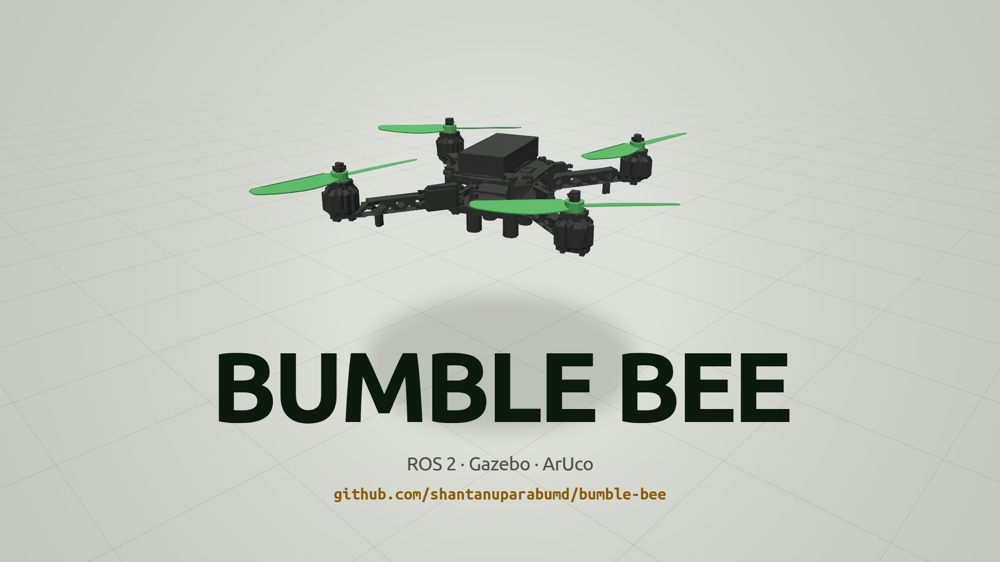
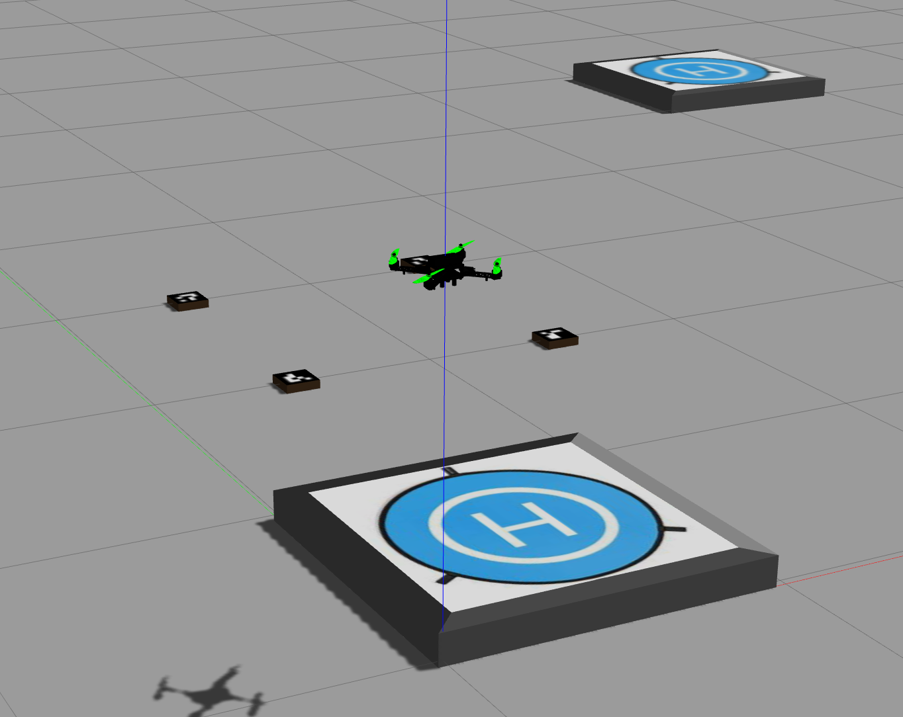

# Bumble Bee 🐝

**A quadcopter that delivers parcels in Gazebo: it spots the box, grabs it with a vacuum gripper, and sets it down on the pad.**

[](LICENSE)

[](docs/media/bumble-bee-launch.mp4)

<sub>▶ Click the image for the 20-second launch video.</sub>

Bumble Bee was designed in SolidWorks, exported to URDF, and flown in Gazebo Classic with ROS 2.
Gazebo can't fly a drone out of the box, so a custom plugin (`drone_plugin`) turns rotor speeds into
thrust, publishes the drone's pose for feedback, and acts as a vacuum gripper.
Full write-up: [Unleashing the Power of Simulation Engines: Writing Plugins for Enhanced Drone Simulations](https://medium.com/@shantanuparab99/unleashing-the-power-of-simulation-engines-writing-plugins-for-enhanced-drone-simulations-ab7c847ca432).



## How it works

| Piece | What it does | Where |
|---|---|---|
| **Flight plugin** | Thrust `k_t·ω²` along each rotor axis, reaction torque `k_q·ω\|ω\|`, net torque yaws the body (`k_t = 0.00025`, `k_q = 7.4e-6`) | `drone_plugin/src/drone_plugin.cpp` |
| **Vacuum gripper** | When the gripper is enabled and all four landing legs touch the same box, the box is welded to the body with a fixed joint | `drone_plugin` |
| **Flight controller** | PID on height, roll, pitch, and yaw → per-rotor speeds; switches gains when carrying a parcel (117 → 118 rad/s base speed) | `drone_delivery/src/fly.cpp` |
| **Mission** | Visits 4 pick-up spots and 4 drop zones: fly over, descend, grip, carry, release | `drone_delivery/src/pick_and_drop.cpp` |
| **Perception** | Detects and labels the ArUco (4×4) ID on each box from the downward camera | `drone_delivery/scripts/aruco_detector.py` |

> `drone_plugin` was rebuilt from the write-up above after the original package was lost; its
> interface matches what `fly` and `deliver` expect, and a headless run completes a full pick-up and drop-off.
>
> The detector currently visualizes IDs; pick-up and drop-off coordinates are fixed in
> `pick_and_drop.cpp`. Feeding detections into the mission is the natural next step.

### Topics

| Topic | Type | Direction |
|---|---|---|
| `motor_speed` | `drone_plugin/msg/MotorSpeed` (`name[]`, `velocity[]`) | `fly` → plugin |
| `drone_pose` | `geometry_msgs/PoseStamped` | plugin → `fly`, `deliver` |
| `drone_velocity` | `geometry_msgs/Twist` | plugin → (spare) |
| `enable_gripper` | `std_msgs/Bool` | `deliver` → plugin |
| `part_attached` | `std_msgs/Bool` | plugin → `fly`, `deliver` |
| `height`, `target_x`, `target_y` | `std_msgs/Float64` | `deliver` → `fly` |

## Quick start

Requires ROS 2 Humble and Gazebo Classic 11.

```bash
mkdir -p ~/bee_ws/src && cd ~/bee_ws/src
git clone https://github.com/shantanuparabumd/bumble-bee.git
cd ~/bee_ws
rosdep install --from-paths src --ignore-src -y
colcon build && source install/setup.bash

ros2 launch drone_delivery gazebo.launch.py        # world + drone
ros2 run drone_delivery fly                        # flight controller   (new terminal)
ros2 run drone_delivery deliver                    # delivery mission    (new terminal)
ros2 run drone_delivery aruco_detector.py          # optional: camera view with ArUco IDs
```

### Or build in Docker

```bash
docker build -t bumble-bee:humble docker/
docker run --rm -it -v "$PWD":/ws/src/drone_delivery bumble-bee:humble \
  bash -c "cd /ws && colcon build && source install/setup.bash && bash"
```

## Repository layout

```
├── drone_delivery/   ROS 2 package: URDF, meshes, worlds, box/pad models, launch, fly + deliver nodes, scripts
├── drone_plugin/     Gazebo plugin (libdrone.so) and the MotorSpeed message
├── docker/           Reproducible build environment (ROS 2 Humble + Gazebo 11)
└── docs/media/       Launch video and screenshots
```

## License

MIT, see [LICENSE](LICENSE).
