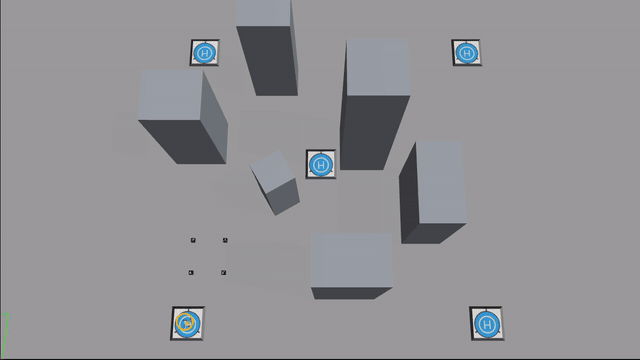
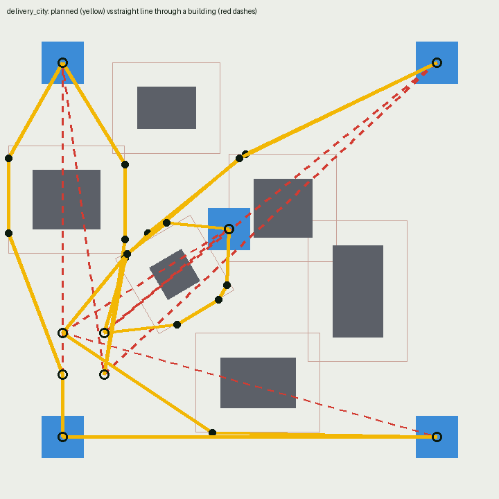
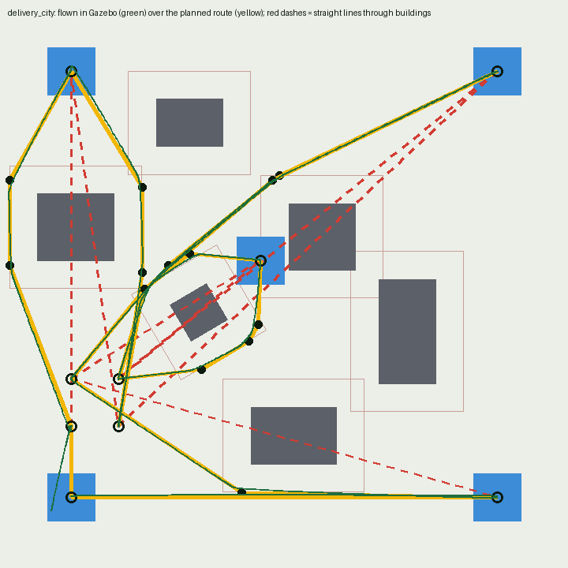

# Bumble Bee 🐝

**A quadcopter that plans its own route around buildings and delivers parcels in Gazebo: it plans each leg with A*, flies it as a smooth minimum-snap trajectory, grabs the box with a vacuum gripper, and sets it down on the pad.**

[](LICENSE)

## Path planning: flying around buildings



`delivery_city` is the delivery area with six buildings in the way: 7 of the mission's 9 straight-line legs
run through one. The planner in [`path_planning/`](path_planning) routes every leg around them, offline,
and writes a mission file that the `deliver` node flies.



| Step | What it does | Where |
|---|---|---|
| **Obstacles** | Every building taller than the 0.7 m cruise height, as its footprint rectangle (rotation included) | `path_planning/planner.py` |
| **Clearance** | Paths keep 0.59 m from every wall: the drone's 0.19 m radius plus a 0.40 m margin for tracking error and corner cutting | `planner.py` |
| **Search** | A* on a 5 cm grid, 8-connected, then string pulling: from each kept point, jump to the farthest point still in clear view. A leg that is already clear stays one straight line | `planner.py` |
| **Trajectory** | A minimum-snap curve through each route: 7th-order segments, at rest at both ends, at most 2 m/s and 2 m/s². Any segment that comes within 0.55 m of a wall is split and refitted | `path_planning/trajectory.py` |
| **Flight** | `deliver` publishes the trajectory as a moving target (`target_ref`: `[x, y, vx, vy, ax, ay]` at 50 Hz) and `fly` feeds the velocity and acceleration forward | `drone_delivery/src/pick_and_drop.cpp`, `fly.cpp` |

**Results** on `delivery_city`, in Gazebo:

- The plan is 68.7 m long against 64.8 m in straight lines; no leg is more than 20% longer. The whole mission plans in about 8 s.
- All four parcels were delivered and the drone landed home. Its centre came no closer than 0.47 m to a wall, so the props kept 0.28 m clear.

| | Corner by corner (waypoints) | Minimum-snap trajectory |
|---|---|---|
| Time flying between stops | 107.6 s | 74.2 s |
| Whole mission, first leg to home | 189.0 s | 164.1 s |
| Near-stops mid-leg | 10 | 0 |
| Closest approach to a wall | 0.50 m | 0.47 m |



### Plan and fly it

```bash
pip install -r path_planning/requirements.txt
python3 path_planning/plan_mission.py delivery_city   # -> path_planning/missions/delivery_city.yaml + .png
python3 -m pytest path_planning/tests                 # clearance and trajectory checks

ros2 launch drone_delivery gazebo.launch.py \
    world:=$(ros2 pkg prefix drone_delivery)/share/drone_delivery/worlds/delivery_city.world
ros2 run drone_delivery fly                                                     # new terminal
ros2 run drone_delivery deliver --ros-args -p mission:=$PWD/path_planning/missions/delivery_city.yaml \
    -p route_mode:=trajectory                                                   # new terminal
```

Leave out `route_mode` to steer at each corner in turn, or `mission` to fly the original four deliveries in
straight lines. The planned mission is already in the repository, so planning again is only needed after
changing `path_planning/courses/delivery_city.yaml`.

Check a flight log against the plan (CSV columns `t,x,y,z`):

```bash
python3 path_planning/check_clearance.py delivery_city pose.csv
python3 path_planning/plot_flight.py delivery_city pose.csv -o flight.png
```

## The drone

https://github.com/user-attachments/assets/365e1bb8-0c45-4f4b-a397-afb03b404c54


Bumble Bee was designed in SolidWorks, exported to URDF, and flown in Gazebo Classic with ROS 2.
Its 5-inch-class frame flies with the mass and rotor model of a published research quadrotor (see [Physical model](#physical-model)).
Gazebo can't fly a drone out of the box, so a custom plugin (`drone_plugin`) turns rotor speeds into
thrust, publishes the drone's pose for feedback, and acts as a vacuum gripper.
Full write-up: [Unleashing the Power of Simulation Engines: Writing Plugins for Enhanced Drone Simulations](https://medium.com/@shantanuparab99/unleashing-the-power-of-simulation-engines-writing-plugins-for-enhanced-drone-simulations-ab7c847ca432).


### How it works

| Piece | What it does | Where |
|---|---|---|
| **Flight plugin** | Thrust `c₂ω² + c₁ω + c₀` along each rotor axis (rotor speed capped at 3000 rad/s); reaction torque `κ·thrust` on the body, whose net yaws the drone | `drone_plugin/src/drone_plugin_.cpp` |
| **Vacuum gripper** | When the gripper is enabled and all four landing legs touch the same box, the box is welded to the body with a fixed joint | `drone_plugin` |
| **Flight controller** | 100 Hz cascaded PID: x/y position → tilt, then height, roll, pitch and yaw → per-rotor speeds around the hover speed; switches gains when carrying a parcel (738.4 → 780.2 rad/s hover speed) | `drone_delivery/src/fly.cpp` |
| **Mission** | Visits 4 pick-up spots and 4 drop zones (fly over, descend, grip, carry, release), then flies home and lands on the pad it took off from. Given a mission file, it flies each leg through planned waypoints instead of a straight line | `drone_delivery/src/pick_and_drop.cpp` |
| **Perception** | Detects and labels the ArUco (4×4) ID on each box from the downward camera | `drone_delivery/scripts/aruco_detector.py` |

> The detector currently visualizes IDs; pick-up and drop-off coordinates are fixed in
> `pick_and_drop.cpp`. Feeding detections into the mission is the natural next step.

### Physical model

The geometry comes from the SolidWorks model; the mass, inertia and rotor model come from the default
quadrotor in [Flightmare](https://github.com/uzh-rpg/flightmare) (UZH Robotics and Perception Group,
[`quadrotor_env.yaml`](https://github.com/uzh-rpg/flightmare/blob/master/flightlib/configs/quadrotor_env.yaml)),
so the numbers are traceable to a published simulator model rather than to a CAD export.
The inertia uses Flightmare's own formula with this frame's arm length.

| Quantity | Value | Where |
|---|---|---|
| Mass | 0.73 kg: body 0.697, four 5 g props, four 2 g legs, 5 g camera | `drone.urdf.xacro` |
| Arm length | 0.12 m (240 mm motor-to-motor diagonal) | SolidWorks model |
| Inertia | diag(0.003942, 0.003942, 0.006132) kg·m², from `m/12 · l² · diag(4.5, 4.5, 7)` | `drone.urdf.xacro` |
| Thrust per rotor | `1.3298e-6·ω² + 0.003836·ω − 1.769` N, never negative | `<thrustMap>` in the URDF |
| Yaw reaction torque | `κ = 0.016` N·m per N of thrust | `<torqueToThrust>` |
| Max rotor speed | 3000 rad/s (21.7 N per rotor, thrust-to-weight ≈ 12) | `<maxRotorSpeed>` |
| Prop spin (visual) | Each prop turns at its commanded speed ÷ 25, about 30 rad/s at hover, so it reads as spinning on video; lift comes from the thrust force | `<propSpinSlowdown>` |
| Hover speed | 738.4 rad/s empty, 780.2 rad/s with a parcel (g = 9.8 m/s², as in the world) | `fly.cpp` |
| Parcel | 0.1 kg, 12 cm cube | `models/box_*/model.sdf`, `worlds/delivery_area.world` |

> The [Medium write-up](https://medium.com/@shantanuparab99/unleashing-the-power-of-simulation-engines-writing-plugins-for-enhanced-drone-simulations-ab7c847ca432)
> and the launch video describe the original model (a 1.4 kg CAD export with `k_t = 0.00025` and a 117 rad/s hover).
> The plugin's structure is the same; only the numbers changed.

### Topics

| Topic | Type | Direction |
|---|---|---|
| `motor_speed` | `drone_plugin/msg/MotorSpeed` (`name[]`, `velocity[]`) | `fly` → plugin |
| `drone_pose` | `geometry_msgs/PoseStamped`, stamped with the sim time of that physics step | plugin → `fly`, `deliver` |
| `drone_velocity` | `geometry_msgs/Twist` | plugin → (spare) |
| `enable_gripper` | `std_msgs/Bool` | `deliver` → plugin |
| `part_attached` | `std_msgs/Bool` | plugin → `fly`, `deliver` |
| `height`, `target_x`, `target_y` | `std_msgs/Float64` | `deliver` → `fly` |

## Quick start

Requires ROS 2 Humble and Gazebo Classic 11.

```bash
mkdir -p ~/bee_ws/src && cd ~/bee_ws/src
git clone https://github.com/shantanu-builds-robots/bumble-bee.git
cd ~/bee_ws
rosdep install --from-paths src --ignore-src -y
colcon build && source install/setup.bash

ros2 launch drone_delivery gazebo.launch.py        # world + drone
ros2 run drone_delivery fly                        # flight controller   (new terminal)
ros2 run drone_delivery deliver                    # delivery mission    (new terminal)
ros2 run drone_delivery aruco_detector.py          # optional: camera view with ArUco IDs
```

### Launch options

`gazebo.launch.py` takes these arguments (defaults in brackets):

| Argument | Meaning |
|---|---|
| `world:=<path>` | Full path of the `.world` file to load [the package's `worlds/delivery_area.world`] |
| `headless:=true` | Physics only, no Gazebo window [`false`] |
| `pause:=true` | Start with physics paused; unpause with the `/unpause_physics` service [`false`] |
| `x:=` `y:=` `z:=` `yaw:=` | Drone spawn pose in metres and radians [`0.5 0.5 0.1 0.0`] |

```bash
ros2 launch drone_delivery gazebo.launch.py headless:=true pause:=true z:=2.0 \
    world:=$(ros2 pkg prefix drone_delivery)/share/drone_delivery/worlds/empty_world.world
```

### Run with Docker

No local ROS install needed: the image has ROS 2 Humble, Gazebo Classic 11 and Bumble Bee already built. From the repository root:

```bash
docker build -f docker/Dockerfile -t bumble-bee .
xhost +local:docker   # once per login: lets the container open windows on your desktop
docker run -it --rm --name bumble-bee --net=host -e DISPLAY=$DISPLAY -v /tmp/.X11-unix:/tmp/.X11-unix bumble-bee \
  ros2 launch drone_delivery gazebo.launch.py

# more terminals, while it runs:
docker exec -it bumble-bee bash -ic "ros2 run drone_delivery fly"
docker exec -it bumble-bee bash -ic "ros2 run drone_delivery deliver"
```

Gazebo renders in software unless the container can reach your GPU: add `--device /dev/dri` (Intel/AMD) or `--gpus all` (NVIDIA, with the NVIDIA Container Toolkit) to `docker run`.

## Repository layout

```
├── path_planning/    A* planner, minimum-snap trajectories, the delivery_city course and its planned mission
├── drone_delivery/   ROS 2 package: URDF, meshes, worlds, box/pad models, launch, fly + deliver nodes, scripts
├── drone_plugin/     Gazebo plugin (libdrone.so) and the MotorSpeed message
├── docker/           Reproducible build environment (ROS 2 Humble + Gazebo 11)
└── docs/media/       Screenshots
```

## License

MIT, see [LICENSE](LICENSE).
